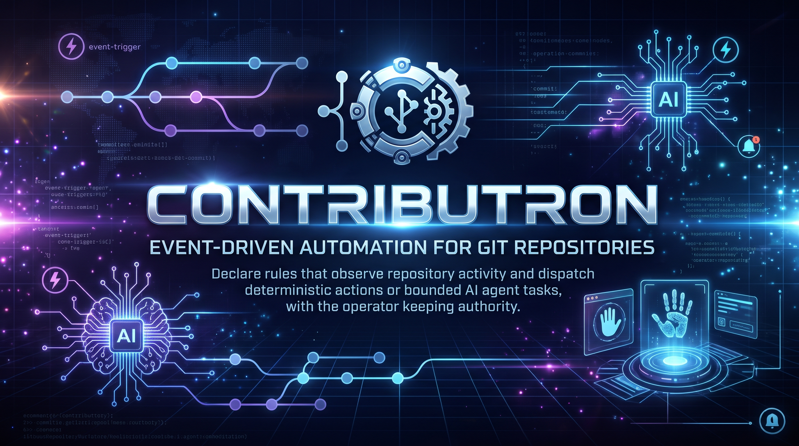

# Contributron

<p align="center">
  
</p>

<p align="center">
  <strong>Rules that watch your repositories and dispatch AI agents on event, without taking your authority away</strong>
</p>

<p align="center">
  <a href="LICENSE"></a>
  <a href="https://github.com/Isonimus/contributron/actions/workflows/ci.yml"></a>
  <a href="https://github.com/Isonimus/contributron/actions/workflows/docs.yml"></a>
  <a href="https://github.com/Isonimus/contributron/actions/workflows/codeql.yml"></a>
  <a href="https://github.com/Isonimus/contributron/actions/workflows/supply-chain.yml"></a>
  
  <a href="https://www.npmjs.com/package/@isonimus/stele"></a>
  
</p>

<p align="center">
  <a href="#status">Status</a> &bull;
  <a href="#the-shape-of-the-plan">The plan</a> &bull;
  <a href="#decisions-worth-knowing-before-reading-the-code">Decisions</a> &bull;
  <a href="#this-repository-governs-itself">Checks</a> &bull;
  <a href="#contributing">Contributing</a> &bull;
  <a href="#built-with-stele">Method</a>
</p>

Event-driven automation for Git repositories. An operator declares rules that observe
repository activity (pull requests, review threads, pipelines, issues) and dispatch work on
event: a deterministic action, or an AI agent given a bounded task and an explicit set of
permitted capabilities.

The operator keeps authority. The system reduces their workload without taking away their
decisions.

## Status

**It can see and remember.** Two slices of milestone M1 have landed: a recorded GitHub
payload becomes a normalized observation of a pull request and its review threads (slice
0007), and that observation persists in a local SQLite store keyed by its content identity,
so re-observing the same state is a no-op the database enforces rather than a check the
caller remembered to perform (slice 0009, ADR-0010). Read-only. Nothing is polled, no rule
fires, and no agent exists yet.

Governance came first, and that ordering was deliberate. The design this project starts from
is a multi-year platform, and the decisions that narrow it to something reachable are more
valuable written down and arguable than implicit in code nobody can question later.

```console
$ contributron render --capture crates/github/tests/fixtures/pull_request_with_threads.json
#1 fix(index): escape backslashes before pipes in table cells
  unresolved threads: 1
```

Recording a pull request from the live API needs a read token, taken from
`CONTRIBUTRON_GITHUB_TOKEN` or from `git credential`. Nothing is stored: how credentials are
really acquired is an open decision, due before anything writes, and it is a line in
[`LEDGER.md`](LEDGER.md).

```console
$ contributron capture --repo owner/name --pull-request 1 --out capture.json
```

Observations persist in a local SQLite file, keyed by the content digest from ADR-0008.
Two writes of the same unchanged state leave one row; a process restart loses nothing.

```console
$ contributron record --capture capture.json --store ./events.sqlite3
recorded
$ contributron list --store ./events.sqlite3
#1 fix(index): escape backslashes before pipes in table cells
  unresolved threads: 1
```

| What | Where |
|---|---|
| Why each choice was made | [`adr/`](adr/), indexed in [`adr/INDEX.md`](adr/INDEX.md) |
| The sequenced plan, M0 through M5 | [`docs/roadmap.md`](docs/roadmap.md) |
| Open work, deferrals, known defects | [`LEDGER.md`](LEDGER.md) |
| The standard code is held to | [`docs/quality-bar.md`](docs/quality-bar.md) |
| Repo-specific conventions and invariants | [`CLAUDE.md`](CLAUDE.md) |

GitHub issues and milestones mirror the ledger for navigation. The ledger is authoritative:
where they disagree, the issue is wrong (ADR-0006).

## The shape of the plan

Five founding principles outlive any milestone. The two that constrain the most code:

**The engine is the security boundary, never the agent.** Repository content, comments and
issues are attacker-controlled input. An agent that asks for an unauthorized action
receives a denial, not an opportunity to argue. No agent approves its own work, merges,
touches a protected branch, alters permissions or disables an audit record.

**The provider is the final authority on provider state.** Mergeability, approvals and
branch protection are re-fetched immediately before any sensitive operation. An agent's
claim that something is ready is evidence, not authorization.

Milestones, in order: observation (read-only), deterministic reaction (rules without AI),
agent execution (read-only investigation in an isolated worktree), supervised mutation
(agent-authored changes behind operator approval), then extraction (the rule language,
designed from three workflows that exist rather than from anticipation).

## Decisions worth knowing before reading the code

- One provider adapter, GitHub, and no abstraction until the second one exists (ADR-0001).
- Rust for the core; Node is present only to run the document toolchain (ADR-0002).
- Polling before webhooks, because a workstation behind NAT cannot receive one and
  reconciliation is required regardless (ADR-0003).
- No rule language until three workflows exist as ordinary Rust (ADR-0004).
- Single operator, but the user/worker/agent distinction is first-class from the first
  commit, because that is the part that is expensive to retrofit (ADR-0005).

## This repository governs itself

Conventions here are executable or they are declared unenforceable out loud. A pre-commit
hook runs the document invariants against the commit rather than the working tree, so a fix
left unstaged cannot green a red commit.

```
npm run lint       # document invariants
npm run index      # regenerate adr/INDEX.md
npm run immutable  # immutable bodies have only gained lines
```

That machinery is [`@isonimus/stele`](https://github.com/Isonimus/stele), vendored rather
than depended on.

## Contributing

[`CONTRIBUTING.md`](CONTRIBUTING.md) has the detail. At this stage the most useful
contribution is an argument against a recorded decision rather than code: the ADRs narrow a
much larger design, and a narrowing that is wrong is cheapest to fix now.

A change that affects what an agent is permitted to do, which credentials reach which
process, or what an operator is asked to approve gets a slower review and should say so in
the pull request. [`SECURITY.md`](SECURITY.md) states what counts as a security issue and why
an agent is never treated as a security boundary.

By participating you agree to the [Code of Conduct](CODE_OF_CONDUCT.md).

## Built with Stele

This repo is developed with **[Stele](https://www.npmjs.com/package/@isonimus/stele)**, a
documentation-as-decisions method. Every durable decision is written as an immutable **ADR**
([`adr/`](adr/)) and every feature as a **slice** before the code, shipped in the same commit
and frozen once merged, so the record of why is never rewritten, only superseded. Open work
lives in a single [`LEDGER.md`](LEDGER.md); [`adr/INDEX.md`](adr/INDEX.md) is generated; and a
pre-commit hook, with CI as its backstop, runs the linter on every commit. The conventions
live in [`CLAUDE.md`](CLAUDE.md). If the layout looks unusual, that is why: the commit history
is meant to read as a trail of decisions.

Stele also supplies the one thing a goal needs before an agent can be set loose on it. A
slice's `## Definition of Done` is written as Given/When/Then before any code, and rule R11
fails the commit if the verification it names is not wired up. That is what stops "done" from
being a judgement the author gets to make about their own work.

## License

MIT.
